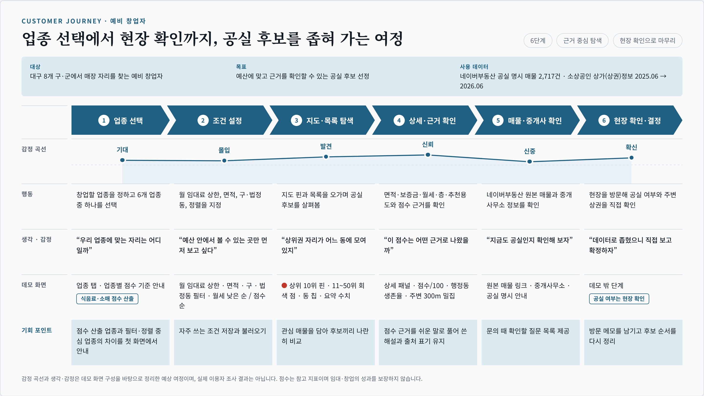

# 대구 공실 매칭 고객 여정 지도

「대구 공실 매칭 · 8개 구·군」 데모의 화면 구성(업종 선택, 조건 필터, 지도·목록, 점수 근거, 원본 매물 링크)을 기준으로 예비 창업자의 여정을 정리했습니다.

- 인터랙티브 원본(16:9 HTML): [12_고객여정지도_대구_공실매칭.html](12_고객여정지도_대구_공실매칭.html)

## 페르소나

| 항목 | 내용 |
|---|---|
| 대상 | 대구 8개 구·군에서 매장 자리를 찾는 예비 창업자 |
| 목표 | 예산에 맞고 근거를 확인할 수 있는 공실 후보 선정 |
| 사용 데이터 | 네이버부동산 공실 명시 매물 2,717건 · 소상공인 상가(상권)정보 2025.06 → 2026.06 |

## 여정 6단계

| 구분 | 1. 업종 선택 | 2. 조건 설정 | 3. 지도·목록 탐색 | 4. 상세·근거 확인 | 5. 매물·중개사 확인 | 6. 현장 확인·결정 |
|---|---|---|---|---|---|---|
| **행동** | 창업할 업종을 정하고 6개 업종 중 하나를 선택 | 월 임대료 상한, 면적, 구·법정동, 정렬을 지정 | 지도 핀과 목록을 오가며 공실 후보를 살펴봄 | 면적·보증금·월세·층·추천용도와 점수 근거를 확인 | 네이버부동산 원본 매물과 중개사무소 정보를 확인 | 현장을 방문해 공실 여부와 주변 상권을 직접 확인 |
| **생각·감정** | “우리 업종에 맞는 자리는 어디일까” | “예산 안에서 볼 수 있는 곳만 먼저 보고 싶다” | “상위권 자리가 어느 동에 모여 있지” | “이 점수는 어떤 근거로 나왔을까” | “지금도 공실인지 확인해 보자” | “데이터로 좁혔으니 직접 보고 확정하자” |
| **데모 화면** | 업종 탭 · 업종별 점수 기준 안내 (식음료·소매 점수 산출) | 월 임대료 상한 · 면적 · 구 · 법정동 필터 · 월세 낮은 순 / 점수 순 | 상위 10위 핀 · 11~50위 회색 점 · 동 칩 · 요약 수치 | 상세 패널 · 점수/100 · 행정동 생존율 · 주변 300m 밀집 | 원본 매물 링크 · 중개사무소 · 공실 명시 안내 | 데모 밖 단계 (공실 여부는 현장 확인) |
| **기회 포인트** | 점수 산출 업종과 필터·정렬 중심 업종의 차이를 첫 화면에서 안내 | 자주 쓰는 조건 저장과 불러오기 | 관심 매물을 담아 후보끼리 나란히 비교 | 점수 근거를 쉬운 말로 풀어 쓴 해설과 출처 표기 유지 | 문의 때 확인할 질문 목록 제공 | 방문 메모를 남기고 후보 순서를 다시 정리 |

## 감정 곡선 (예상)

| 단계 | 1 | 2 | 3 | 4 | 5 | 6 |
|---|---|---|---|---|---|---|
| 감정 | 기대 | 몰입 | 발견 | 신뢰 | 신중 | 확신 |
| 수준(0~100) | 68 | 66 | 82 | 90 | 62 | 78 |

수준 값은 곡선 그래프를 그리기 위한 상대적 표시값입니다.

## 데모 파일에서 가져온 근거

- 업종은 식음료, 공연·문화, 소매, 교육, 의료·뷰티, 사무·업무 6개로 구성됩니다.
- 점수는 생존율 검증을 통과한 업종(식음료, 소매)에만 산출하고, 나머지 업종은 조건 필터와 정렬 중심으로 보여줍니다.
- 점수 요인은 행정동 생존율(표본이 적은 행정동은 전체 평균 쪽으로 축소 추정)과 주변 300m 밀집도이며, 소매는 행정동 주거인구도 함께 반영합니다.
- 지도에서 상위 10위는 빨간 핀, 11~50위는 회색 점으로 표시합니다.
- 상세 패널에서 전용 면적, 보증금, 월세, 층, 현재용도, 추천용도, 중개사무소, 특징을 확인하고 네이버부동산 원본 매물로 이동할 수 있습니다.
- 배경지도는 국토교통부 브이월드를 사용합니다.

## 유의 사항

- 감정 곡선과 생각·감정은 데모 화면 구성을 바탕으로 정리한 예상 여정이며, 실제 이용자 조사 결과는 아닙니다.
- 공실 여부는 중개사 기재 기준이며 현장 확인이 필요합니다.
- 점수는 참고 지표이며 임대·창업의 성과를 보장하지 않습니다. 생존은 영업 지속 여부이며 매출 성과가 아닙니다.

**출처**: 대구 공실 매칭 · 8개 구·군 데모(대구_공실매칭_데모_8구_v3.html) 화면 구성과 하단 출처 문구
