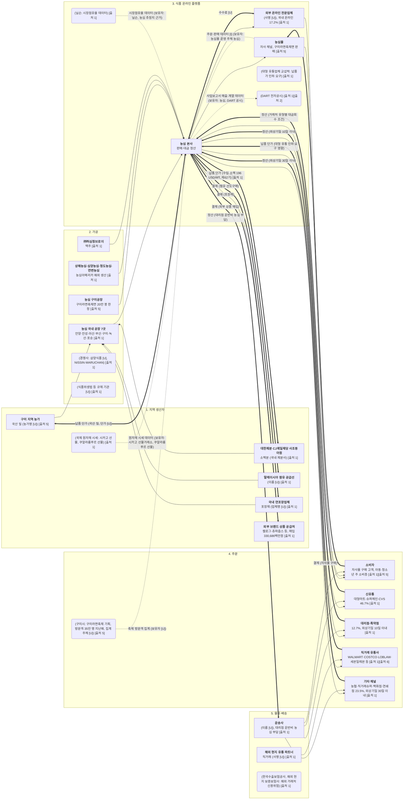

# 농심 산업 밸류체인 (v0)

- **작성일:** 2026-11-06
- **근거 파일:** `research/company/농심/onepager.md` (이 세션에서 읽은 원페이지, 이후 수정 없음)
- **단계:** 팀 지정 5단계 (1 지역 생산자 → 2 가공 → 3 식품 온라인 플랫폼 → 4 주문 → 5 물류·배송)
- **표기:**
  - 굵은 글씨 = 하는 사람 (실행하거나 거래하는 주체)
  - 괄호 `( )` = 영향 주는 사람
  - 상품 흐름 `-->`, 돈 흐름 `==>` (라벨: 결제·수수료·정산·납품 단가), 데이터 흐름 `-.->` (라벨: 데이터 이름·보유자)
  - 숫자는 onepager에 `[출처]`가 있는 것만 적었다. 없는 값은 `[U]`로 두었다.
  - `농심 본사` 노드는 돈과 상품이 모이는 지점으로 두었다. 이해관계자 표에서는 본사를 뺐지만, 흐름을 그리기 위해 넣었다.

## 단계별 근거

| 단계 | 노드 | onepager 칸 | [출처 n] |
|---|---|---|---|
| 1. 지역 생산자 | 구미 지역 농가 (국산 밀) | 5. 파트너 (구미 지역 농가: 국산 밀 공급, 농가명 [U]) | [출처 5] |
| 1. 지역 생산자 | 제분사 (소맥분) | 5. 파트너 (소맥분: 대한제분, CJ제일제당, 사조동아원 등) | [출처 1] |
| 1. 지역 생산자 | 팜유 공급선 | 5. 파트너 (팜유: 말레이시아 주요 공급선, 경쟁입찰 선도구매) | [출처 1] |
| 1. 지역 생산자 | 연포장업체 (포장재) | 5. 파트너 (포장재: 국내 주요 연포장업체, 업체명 [U]) | [출처 1] |
| 1. 지역 생산자 | 외부 브랜드 상품 공급처 | 4. 무엇으로 (원가: 켈로그외 상품 330,686백만원), 5. 파트너 (판매용 상품 매입) | [출처 1] |
| 1. 지역 생산자 | 국제 원자재 시세 (괄호) | 재무·비용 › 2-2 원재료 가격 추이 (산출기준: 시카고 선물, 쿠알라룸푸르 선물) | [출처 1] |
| 2. 가공 | 국내 공장 7곳, 구미공장 | 3. 어떻게 전달 (국내 생산: 공장 7곳), 2. 무엇을 (구미라면축제면 20만 봉 한정 생산) | [출처 1][출처 5] |
| 2. 가공 | 해외 생산 법인 | 3. 어떻게 전달 (해외 생산: 상해·심양·청도·연변, 농심아메리카) | [출처 1] |
| 2. 가공 | ㈜허심청브로이 | 2. 무엇을 (기타 사업: 제조맥주 전용 자회사) | [출처 1] |
| 2. 가공 | 경쟁사 (괄호) | 산업 이슈·경쟁 › 1-6 (미국: NISSIN·MARUCHAN), 2-1 (삼양식품 [U], 웹 출처 검증 전) | [출처 1] |
| 2. 가공 | 규제 기관 (괄호) | 산업 이슈·경쟁 › 1-4 (식품위생법 식품오염 대응·보고 의무, 기관 [U]) | [출처 1] |
| 3. 플랫폼 | 농심 본사 | 3. 어떻게 전달 (판매전략: 이커머스 매출 확대), 4. 무엇으로 (매출 구성) | [출처 1] |
| 3. 플랫폼 | 농심몰 | 3. 어떻게 전달 (자사몰 '농심몰'에서 구미라면축제면 판매 예정) | [출처 5] |
| 3. 플랫폼 | 외부 온라인 전문업체 | 3. 어떻게 전달 (중국: 온라인은 외부 전문업체와 협업), 온라인 17.2% | [출처 1] |
| 3. 플랫폼 | 대형 유통 교섭력 (괄호) | 산업 이슈·경쟁 › 1-4 (음료 업계 납품가 인하·저가 기획제품 요구) | [출처 1] |
| 3. 플랫폼 | 닐슨 (괄호) | 산업 이슈·경쟁 › 1-1 (닐슨 데이터 기준 점유율, 농심 추정치) | [출처 1] |
| 3. 플랫폼 | DART (괄호) | 사업 모델 › 1. 누구에게 (사업보고서 DART 사업보고서 2025.12 기재) | [출처 1][출처 2] |
| 4. 주문 | 소비자 | 1. 누구에게 (스낵 주 소비자 아동·청소년; 자사몰 구매 고객) | [출처 1][출처 5] |
| 4. 주문 | 신유통 | 3. 어떻게 전달 (신유통 46.7%: 대형마트·슈퍼체인·CVS) | [출처 1] |
| 4. 주문 | 대리점·특약점 | 3. 어떻게 전달 (대리점 12.7%, 외상기일 10일 이내), 2-3 판매조건 | [출처 1] |
| 4. 주문 | 직거래 유통사 | 3. 어떻게 전달 (미국 월마트 직거래, 캐나다·일본 유통사), 5. 파트너 | [출처 1][출처 6] |
| 4. 주문 | 기타 채널 | 3. 어떻게 전달 (기타 23.5%: 농협·직거래슈퍼·백화점·연쇄점, 외상기일 30일 이내) | [출처 1] |
| 4. 주문 | 구미시 (괄호) | 5. 파트너 (구미시 축제 기획, 2022년 제1회부터 5년 연속 핵심 파트너) | [출처 5] |
| 5. 물류·배송 | 운송사 | 2-3 판매조건 (대리점 운반비 당사 부담). 운송사명은 원페이지에 없음 | [출처 1] |
| 5. 물류·배송 | 해외 현지 유통 파트너 | 3. 어떻게 전달 (해외 직거래: 호주·베트남·유럽) | [출처 1] |
| 5. 물류·배송 | 수출보험·보증보험 (괄호) | 5. 파트너 (금융·보험: 해외 거래처 신용위험 보증보험) | [출처 1] |

## 메모

- **수수료:** onepager에 플랫폼 수수료율이나 금액이 없다. 그래서 흐름 라벨은 `수수료 [U]`로만 두었다.
- **물류·배송:** 운송사명, 배송 수단, 물류비 금액이 없다. 5단계의 근거가 약하다. `물류비 금액 [U]`는 재무·비용 › 2-3에 있다.
- **데이터 흐름:** onepager에 주문·판매 데이터라는 기재는 없다. 농심몰 주문 데이터는 `[I]`로 표시했다.
- **단계명:** 이 표는 팀이 이번에 지정한 5단계(지역 생산자 · 가공 · 식품 온라인 플랫폼 · 주문 · 물류·배송)를 따랐다. 이해관계자·활동 표의 단계명(원천·소싱, 가공·제작, 플랫폼·유통, 주문·구매, 전달·서비스)과 다르다.
