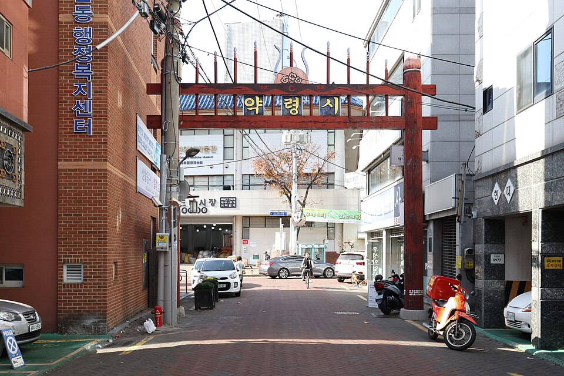
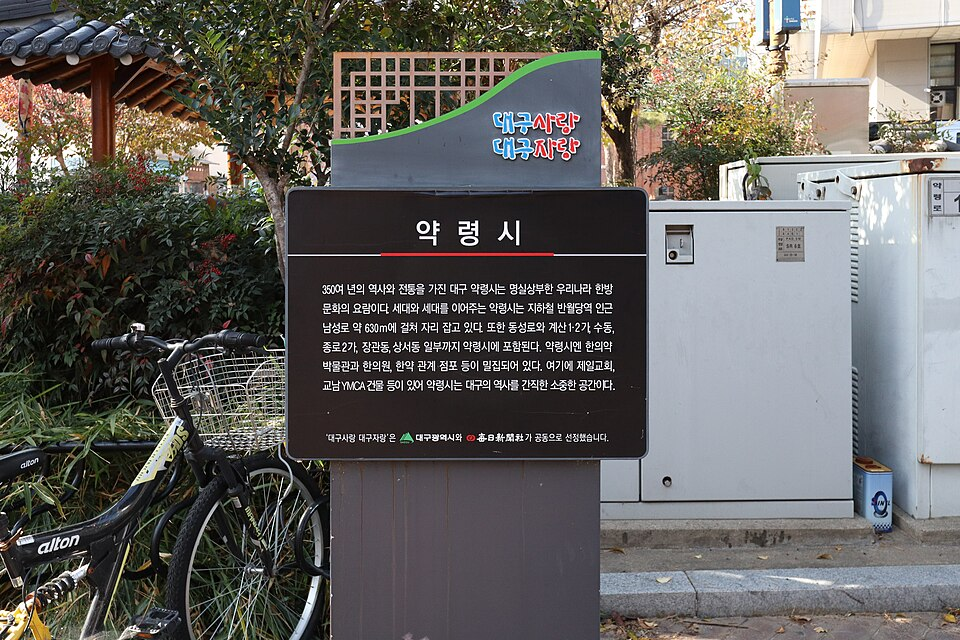
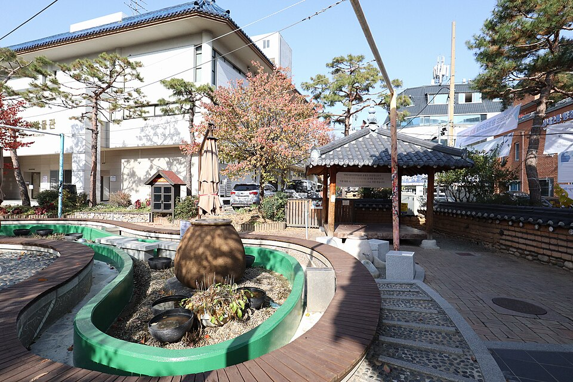
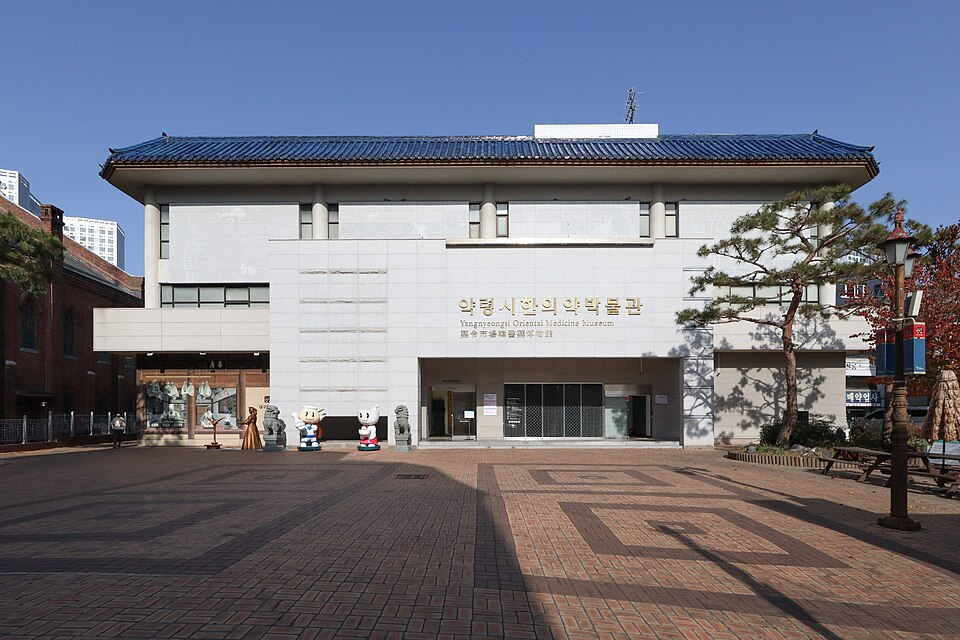
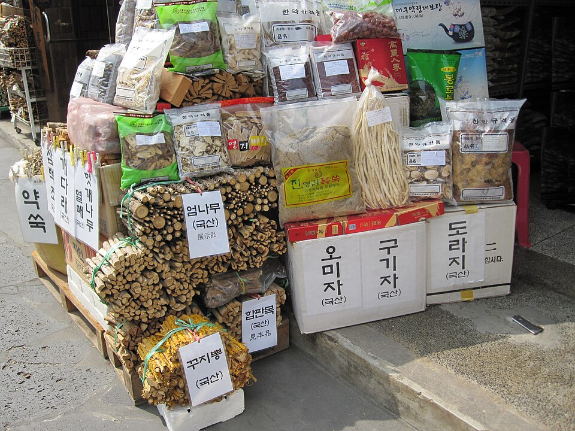

# 대구 약령시 사진 5장

사진은 Wikimedia Commons의 자유 이용 가능 이미지를 960px 크기로 내려받아 `images` 폴더에 저장한 것입니다.

## 1. 약령시 거리 (1)

- 촬영: 2022-11-26, Mobius6 / 라이선스: CC BY-SA 4.0
- 원본: https://commons.wikimedia.org/wiki/File:Yangnyeongsi_(Daegu)_20221126_001.jpg

## 2. 약령시 거리 (2)

- 촬영: 2022-11-26, Mobius6 / 라이선스: CC BY-SA 4.0
- 원본: https://commons.wikimedia.org/wiki/File:Yangnyeongsi_(Daegu)_20221126_002.jpg

## 3. 약령시 거리 (3)

- 촬영: 2022-11-26, Mobius6 / 라이선스: CC BY-SA 4.0
- 원본: https://commons.wikimedia.org/wiki/File:Yangnyeongsi_(Daegu)_20221126_004.jpg

## 4. 대구 약령시 한의약박물관

- 촬영: 2022-11-26, Mobius6 / 라이선스: CC BY-SA 4.0
- 원본: https://commons.wikimedia.org/wiki/File:Yangnyeongsi_Oriental_Medicine_Museum_(Daegu)_20221126_001.jpg

## 5. 약령시 전통 한약재

- 촬영: 2010-07-30, WolfgangMichel / 라이선스: CC0 (퍼블릭 도메인)
- 원본: https://commons.wikimedia.org/wiki/File:Crude-Korean-Drugs-Daegu-Market.JPG

## 이용 시 유의사항

- 1~4번은 CC BY-SA 4.0이라 사용할 때 촬영자(Mobius6) 표기가 필요하고, 변형해 배포하면 같은 조건으로 공개해야 한다.
- 발표 자료나 보고서에 쓸 때도 위 출처와 라이선스를 함께 적는다.
