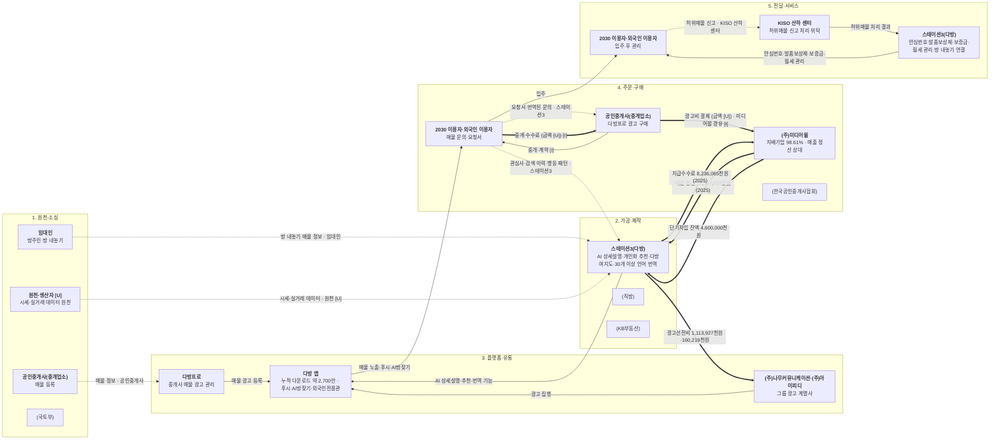

# 다방이 속한 주거 부동산 중개 플랫폼 산업 밸류체인 v0

> 작성 메모
> - 작성일은 2026-11-16이고, 근거는 [research/company/다방/onepager.md](../research/company/다방/onepager.md) 하나다.
> - 요청 단계는 식품 산업용(지역 생산자 → … → 물류·배송)이었다. 알스퀘어 때 팀과 정한 대로 FigJam 5단계(원천·소싱 → 가공·제작 → 플랫폼·유통 → 주문·구매 → 전달·서비스)로 바꿔 그렸다.
> - 노드 표기
>   - **굵은 글씨**는 그 단계에서 직접 활동하는 사람이다.
>   - (괄호)는 영향을 주는 사람이다. 영향 주는 사람은 흐름선 없이 단계 안에만 둔다.
>   - 이름이 원페이저에 없으면 '유형 이름 [U]'로 적었다.
> - 흐름선 표기
>   - `-->`는 상품·서비스 흐름이다.
>   - `==>`는 돈 흐름이다(결제·수수료·정산·납품 단가·자금).
>   - `-.->`는 데이터 흐름이다(데이터 이름 · 보유자).
> - 숫자는 원페이저에 [출처]가 붙은 것만 썼다. 수수료율이나 거래별 금액이 원페이저에 없으면 숫자 없이 [U]로 적었다.

## 단계별 근거 (원페이저 칸)

### 노드
| 단계 | 노드 | 구분 | 원페이저 칸 | 출처 |
|---|---|---|---|---|
| 1 원천·소싱 | 공인중개사(중개업소) (매물 등록) | 하는 사람 | A①, A② | [출처 8][출처 12] |
| 1 원천·소싱 | 임대인 | 하는 사람 | A①, A③ (우리집 서비스) | [출처 8][출처 30] |
| 1 원천·소싱 | 원천·생산자 [U] (시세 데이터) | 하는 사람 | A② 다방여지도 (데이터 원천 이름 없음) | [출처 4] |
| 1 원천·소싱 | (국토부) | 영향 주는 사람 | D 산업 이슈 1 | [출처 46][출처 49] |
| 2 가공·제작 | 스테이션3(다방) | 하는 사람 | A②, A③, C#1 | [출처 3][출처 4][출처 31] |
| 2 가공·제작 | (직방) | 영향 주는 사람 | D 산업 이슈 3, D 비교표 | [출처 43][출처 44] |
| 2 가공·제작 | (KB부동산) | 영향 주는 사람 | D 산업 이슈 3 | [출처 20] |
| 3 플랫폼·유통 | 다방 앱 | 하는 사람 | A③, C#1 | [출처 3][출처 5][출처 7][출처 13][출처 31] |
| 3 플랫폼·유통 | 다방프로 | 하는 사람 | A②, A③ | [출처 12] |
| 3 플랫폼·유통 | (주)나무커뮤니케이션·(주)아이피디 | 하는 사람 | A⑤ | [출처 1] |
| 4 주문·구매 | 공인중개사(중개업소) (광고 구매) | 하는 사람 | A④ | [출처 12] |
| 4 주문·구매 | 2030 이용자·외국인 이용자 | 하는 사람 | A①, C#1, C#2 | [출처 4][출처 30][출처 31] |
| 4 주문·구매 | (주)미디어윌 | 하는 사람 | A④, A⑤, B 매출 구성 | [출처 1] |
| 4 주문·구매 | (한국공인중개사협회) | 영향 주는 사람 | A⑤ | [출처 7] |
| 5 전달·서비스 | 스테이션3(다방) (서비스) | 하는 사람 | C#2, C#3 | [출처 7][출처 30] |
| 5 전달·서비스 | KISO 산하 센터 | 하는 사람 | A⑤, C#3 | [출처 7] |
| 5 전달·서비스 | 2030 이용자·외국인 이용자 (입주 후) | 하는 사람 | C#2 | [출처 30] |

### 흐름선과 숫자
| 흐름 | 선 | 라벨의 숫자 | 원페이저 칸 | 출처 |
|---|---|---|---|---|
| 공인중개사 → 다방프로 | 데이터 | — | A② | [출처 12] |
| 임대인 → 스테이션3 | 데이터 | — | A③ (방 내놓기) | [출처 30] |
| 시세 원천 → 스테이션3 | 데이터 | — | A② | [출처 4] · 원천 이름은 [U] |
| 이용자 → 스테이션3 | 데이터 | — | A③ | [출처 3] |
| 이용자 → 공인중개사 | 데이터 | — | C#1, C#2 | [출처 30][출처 31] |
| 이용자 → KISO 산하 센터 | 데이터 | — | A⑤, C#3 | [출처 7] |
| 다방프로 → 다방 앱 | 상품 | — | A②, A③ | [출처 12] |
| 스테이션3 → 다방 앱 | 상품 | — | A③ | [출처 3][출처 4][출처 5] |
| 광고 계열사 → 다방 앱 | 상품 | — | A⑤ | [출처 1] |
| 다방 앱 → 이용자 | 상품 | 다운로드 약 2,700만 (노드 라벨) | A③ | [출처 7][출처 13] |
| 공인중개사 → 이용자 | 상품 | — | 없음 | [I] 중개 서비스 자체는 원페이저에 없다 |
| 스테이션3 → 이용자 (서비스) | 상품 | — | C#2, C#3 | [출처 7][출처 30] |
| 공인중개사 → 미디어윌 | 돈 (결제) | 금액 [U] | A④ | [출처 1][출처 12] · 미디어윌을 거친다는 건 [I] |
| 미디어윌 → 스테이션3 | 돈 (정산) | 15,107,425천원 | A④, B 매출 구성 | [출처 1] |
| 스테이션3 → 미디어윌 | 돈 (수수료) | 8,236,065천원 | B 주요 비용 | [출처 1] |
| 미디어윌 → 스테이션3 | 돈 (자금) | 4,600,000천원 | B 재무 구조 | [출처 1] |
| 스테이션3 → 광고 계열사 | 돈 (결제) | 1,113,927천원·160,219천원 | A⑤ | [출처 1] |
| 이용자 → 공인중개사 | 돈 (수수료) | 금액 [U] | 없음 | [I] 산업 일반 흐름이며 원페이저에 근거가 없다 |

## 빈 곳 메모
- **이용자는 다방에 돈을 내지 않는다.** 원페이저상 다방의 돈은 중개사 광고비(미디어윌 경유 추정)에서만 들어온다. 이용자는 데이터(행동 패턴·요청서)를 주는 쪽이다.
- 광고비 단가와 중개 수수료율은 원페이저에 없어서 [U]다.
- 시세·지도 데이터의 원천과 번역·AI 기술 공급사는 이름이 없어 [U]로 두었다.
- 상가 매물은 원페이저에서 [U]라서 상가 흐름은 그리지 않았다.
