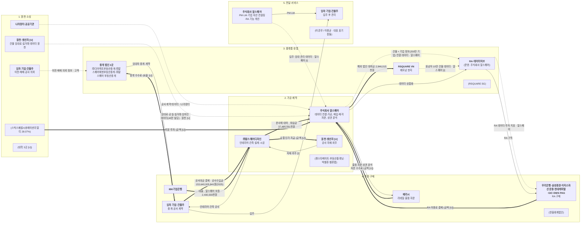

# 알스퀘어가 속한 상업용 부동산 서비스 산업 밸류체인 v0

> 작성 메모
> - 작성일은 2026-11-16이고, 근거는 [research/company/알스퀘어/onepager.md](../research/company/알스퀘어/onepager.md) 하나다.
> - 요청 단계는 식품 산업용(지역 생산자 → … → 물류·배송)이었다. 팀과 확인해 FigJam 5단계(원천·소싱 → 가공·제작 → 플랫폼·유통 → 주문·구매 → 전달·서비스)로 바꿔 그렸다.
> - 노드 표기
>   - **굵은 글씨**는 그 단계에서 직접 활동하는 사람이다.
>   - (괄호)는 영향을 주는 사람이다. 영향 주는 사람은 흐름선 없이 단계 안에만 둔다.
>   - 이름이 원페이저에 없으면 '유형 이름 [U]'로 적었다.
> - 흐름선 표기
>   - `-->`는 상품·서비스 흐름이다.
>   - `==>`는 돈 흐름이다(결제·수수료·정산·납품 단가·자금).
>   - `-.->`는 데이터 흐름이다(데이터 이름 · 보유자).
> - 숫자는 원페이저에 [출처]가 붙은 것만 썼다. 수수료율이나 거래별 금액이 원페이저에 없으면 숫자 없이 [U]로 적었다.

## 단계별 근거 (원페이저 칸)

### 노드
| 단계 | 노드 | 구분 | 원페이저 칸 | 출처 |
|---|---|---|---|---|
| 1 원천·소싱 | 나라장터·공공기관 | 하는 사람 | C#3 | [출처 32] |
| 1 원천·소싱 | 원천·생산자 [U] (건물 데이터 원천) | 하는 사람 | A② RA, C#3 (데이터 규모만 있고 원천 이름은 없다) | [출처 32] |
| 1 원천·소싱 | 임차 기업·건물주 (의뢰) | 하는 사람 | A① | [출처 6][출처 14] |
| 1 원천·소싱 | (스틱스페셜시츄에이션리얼티 28.07%) | 영향 주는 사람 | A⑤ | [출처 1][출처 2] |
| 1 원천·소싱 | (대학 3곳 [U]) | 영향 주는 사람 | C#3 (이름 없음) | [출처 32] |
| 2 가공·제작 | 주식회사 알스퀘어 | 하는 사람 | A②, C#2 | [출처 6][출처 8][출처 31] |
| 2 가공·제작 | ㈜알스퀘어디자인 | 하는 사람 | A②, A③, B 매출 구성 | [출처 1][출처 14] |
| 2 가공·제작 | 원천·생산자 [U] (자재·외주) | 하는 사람 | 없음 [I] (공사수입금 구조로 짐작) | — |
| 2 가공·제작 | (젠스타메이트·부동산플래닛·빅밸류·밸류맵) | 영향 주는 사람 | D 산업 이슈 2, D 비교표 | [출처 40][출처 49][출처 50] |
| 3 플랫폼·유통 | RA·데이터허브 | 하는 사람 | A②, A③ | [출처 5][출처 14] |
| 3 플랫폼·유통 | 중개 법인 3곳 | 하는 사람 | A③ | [출처 1] |
| 3 플랫폼·유통 | RSQUARE VN | 하는 사람 | A③, D 글로벌 확장 경로 | [출처 1][출처 9] |
| 3 플랫폼·유통 | (RSQUARE SG) | 영향 주는 사람 | A③ | [출처 1] |
| 4 주문·구매 | 우리은행·삼성증권·이지스자산운용·현대캐피탈·GIC·DWS·PAG | 하는 사람 | A① | [출처 5][출처 7] |
| 4 주문·구매 | 임차 기업·건물주 (계약) | 하는 사람 | A①, A③ | [출처 1][출처 14] |
| 4 주문·구매 | 베리시 | 하는 사람 | C#2 | [출처 31] |
| 4 주문·구매 | IBK기업은행 | 하는 사람 | A⑤ | [출처 2] |
| 4 주문·구매 | (한울회계법인) | 영향 주는 사람 | B 요약 손익 | [출처 1][출처 2][출처 3] |
| 5 전달·서비스 | 주식회사 알스퀘어 (PM·LM·RA 개선) | 하는 사람 | A②, C#3 | [출처 14][출처 32] |
| 5 전달·서비스 | 임차 기업·건물주 (입주 후) | 하는 사람 | A② | [출처 14] |
| 5 전달·서비스 | (이존우 / 이용균) | 영향 주는 사람 | A⑤, 충돌 항목 #1 | [출처 2][출처 4][출처 9][출처 14] |

### 흐름선과 숫자
| 흐름 | 선 | 라벨의 숫자 | 원페이저 칸 | 출처 |
|---|---|---|---|---|
| 나라장터 → 알스퀘어 | 데이터 | — | C#3 | [출처 32] |
| 건물 데이터 원천 → 알스퀘어 | 데이터 | 40만 빌딩 | A②, C#3 | [출처 32] |
| 알스퀘어 → RA | 데이터 | 250만 기업 | A② | [출처 32] |
| RSQUARE VN → RA | 데이터 | 동남아 10만 건물 | D 글로벌 확장 경로 | [출처 7] · VN이 이 데이터를 가지고 있다는 건 [I] |
| RA → 금융기관 | 데이터·상품 | — | A①, A③ | [출처 5][출처 7] |
| PM → 알스퀘어 | 데이터 | — | 없음 | [I] 관리 데이터가 다시 들어간다는 추정 |
| 중개 법인 → 임차 기업 | 상품 | — | A③, C#2 | [출처 1][출처 31] |
| 알스퀘어디자인 → 임차 기업 | 상품 | — | A②, B 매출 구성 | [출처 1] |
| 알스퀘어 → 베리시 | 상품 | — | C#2 | [출처 31] |
| 자재·외주 → 알스퀘어디자인 | 상품 | — | 없음 | [I] |
| 금융기관 → 알스퀘어 | 돈 (결제) | 금액 [U] | A① | [출처 5][출처 7] · 금액은 원페이저에 없음 |
| 임차 기업 → 중개 법인 | 돈 (수수료) | 요율 [U] | A③ | [출처 1] · 요율은 원페이저에 없음 |
| 임차 기업 → 알스퀘어디자인 | 돈 (결제) | 공사수입금 153,640,005,841원 | B 매출 구성 | [출처 1] · 모든 공사 고객의 합계다 |
| 베리시 → 알스퀘어 | 돈 (수수료) | 금액 [U] | C#2 | [출처 31] |
| 알스퀘어디자인 → 자재·외주 | 돈 (납품 단가) | 금액 [U] | 없음 | [I] |
| 알스퀘어디자인 → 알스퀘어 | 돈 (내부 자금) | 37,485,061천원 | 한눈에 보기 4, B 재무 구조 | [출처 2] |
| 알스퀘어 → RSQUARE VN | 돈 (대여) | 2,946,015천원 | D 글로벌 확장 경로 | [출처 2] |
| IBK기업은행 → 알스퀘어디자인 | 돈 (대출) | 보증 2,400,000천원 | A⑤ | [출처 2] |
| 스틱스페셜시츄에이션리얼티 → 알스퀘어 | 돈 (투자) | 금액 [U] | A⑤ | [출처 1][출처 2] · 누적 투자 1,140억 원 [출처 12]은 투자자 전체 합계라 이 선에는 쓰지 않았다 |

## 빈 곳 메모
- **수수료율은 하나도 없다.** 원페이저에 RA 이용료, 중개 수수료, 자문 수수료의 요율이나 금액이 없다. 그래서 돈 흐름 라벨 대부분이 [U]다.
- 원천 단계에서 이름이 확인된 데이터 원천은 나라장터 하나다. 건물 임대료·실거래 데이터의 원천과 공사 자재·외주 공급사는 [U]다.
- 서비스매출 43,433,140,219원 [출처 1]은 RA·중개·자문이 섞인 합계다. 그래서 특정 돈 흐름 선에는 붙이지 않았다.
