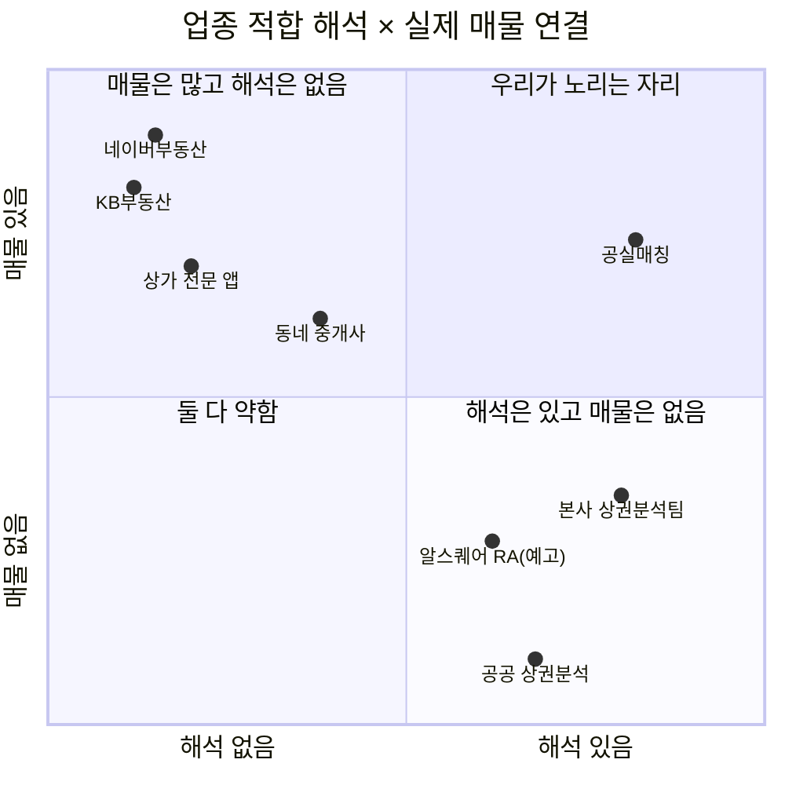

# 3. 시장: 누가 이미 하고, 우리가 얻을 몫은

> 상태: 2026-11-18 초안. 중간 발표 3번 섹션(시장)에서 쓴다.
> 평가 기준 2 "시장·BM 근거"에 맞춰 **경쟁·대체재를 인정**하고, 숫자마다 **[출처]**와 **[가정]**을 나눠 적었다.
> 표기: `[출처]` 공개 자료·팀 조사 파일 / `[가정]` 근거 없는 팀 가정(검증 방법 병기) / `추정` 자료를 바탕으로 한 팀 해석

---

## 1. 슬라이드 메시지 (한 문장)

> **매물을 보여 주는 곳도, 상권을 분석해 주는 곳도 있지만, "이 업종이면 어느 빈 상가인가"를 실제 매물로 답하는 곳은 아직 없다. 그래서 지금 창업자는 발품과 중개사로 이 빈칸을 메운다.**

---

## 2. 경쟁·대체재 비교표

| 구분 | 누구 | 상가 매물 | 업종으로 찾기 | 업종 적합 근거 | 매물 확인일 | 돈을 내는 쪽 | 근거 |
|---|---|---|---|---|---|---|---|
| **직접 경쟁 (매물 플랫폼)** | 네이버부동산 | ✅ 대구 범어동 2,647건 | ❌ 매물에 추천업종만 표시 | ❌ | 확인 필요 | 중개사 광고(추정) | `밸류체인/네이버부동산_valuechain_v0.html` [3]·[8] |
| | KB부동산 | ✅ 범어동 2,571건 | ❌ | ❌ 입지 탭은 역세권 표시뿐 | 확인 필요 | 은행 대출 연계(추정) | `밸류체인/KB부동산_valuechain_v0.html` [4] |
| | 다방·직방·피터팬 | 주거 중심 | ❌ AI 추천은 주거용 | ❌ | 확인 필요 | 중개사 광고(추정) | `밸류체인/다방_valuechain_v0.md`, VOC 허위·미끼 다방 250·직방 106·피터팬 216건 |
| | 상가 전문 앱 (네모·싸장님들·아싸점포거래소·상가나라) | ✅ | 확인 필요 | 확인 필요 | 확인 필요 | 확인 필요 | VOC `고객여정지도/플랫폼_각리뷰/`. "네모앱 상가는 보통 크고 비쌌다"(F-016) |
| **잠재 경쟁** | 알스퀘어 RA | 오피스·기관 중심 | — | 2026년 하반기 '상권분석' 예고, 출시 확인 안 됨 | — | 금융기관 등 60여 곳 | `밸류체인/알스퀘어_valuechain_v0.html` [7]·[8] |
| **대체재 (지금 실제로 쓰는 방법)** | 발품 (직접 돌아다님) | — | 사람이 직접 | 경험에 의존 | 현장에서 확인 | 시간 | 대구 창업 후기 26건 중 다수: "약 20군데 발품"(F-024), "대구 전역 상가 다 봤다"(F-014) |
| | 동네 중개사 소개 | ✅ (비공개 매물 포함) | 중개사 판단 | 중개사 말에 의존 | 중개사 말 | 계약 시 중개보수 | F-005, F-008, F-017. "중개인 말을 그대로 믿지 말라"(F-018) |
| | 프랜차이즈 본사 상권분석팀 | 후보는 가맹점주가 가져옴 | ✅ 본사 기준 | ✅ | — | 가맹비에 포함(추정) | "후보를 본사 상권분석팀에 가져가면 '여기는 안 된다'"(F-011). 가맹점주만 이용 |
| | 공공 상권분석 (소상공인 상권정보시스템 등) | ❌ 매물 없음 | 업종별 상권 통계 | ✅ 통계 | — | 무료 | 여정지도 1단계 터치포인트(`고객여정지도/문서_여정지도_원본.md`). 기능 세부는 확인 필요 |

**인정하는 것 (발표에서 말로)**
- 매물 양은 네이버·KB를 이길 수 없다. 우리 매물도 네이버 공개 매물 스냅샷(2,717건)이다.
- 지금 가장 강한 대체재는 **발품과 중개사**다. 비공개 매물과 현장 정보는 이들만 갖고 있다.
- 알스퀘어가 상권분석을 내면 해석 쪽에서 겹칠 수 있다. 다만 고객이 기관·기업이라 소규모 창업자와는 다르다(추정).

---

## 3. 포지셔닝 맵

- **가로축:** 업종 적합 해석 (없음 → 있음). 이 자리가 내 업종에 맞는지 근거를 주는가
- **세로축:** 실제 빈 상가와 연결 (없음 → 있음). 지금 나와 있는 매물을 바로 보여 주는가

- 점의 위치는 **팀 판단(추정)**이다. 비교표의 ✅/❌를 근거로 놓았다.
- "공실매칭"의 매물 축이 네이버보다 낮은 이유: 매물이 대구 2,717건 스냅샷이고, 지금도 공실인지 확인할 수 없다.

---

## 4. 시장 규모: TAM · SAM · SOM

기준: **"해마다 새로 가게 자리를 찾는 사람 수"**로 센다. 매출액 기준의 큰 숫자는 쓰지 않는다.

| 단계 | 정의 | 계산 | 값 | 구분 |
|---|---|---|---:|---|
| TAM | 전국에서 2025년에 소매·서비스·음식업으로 새로 사업자 등록을 한 사람 | 340,758 + 323,769 + 129,989 | **794,516명** | [출처] 국세청 TASIS 9-8-20 신규사업자 현황 (`권혜림` 브랜치 `data/03. 개업 및 폐업 현황/03.업종별 개,폐업.md`) |
| SAM (전체) | 그중 대구 | 12,326 + 11,721 + 5,583 | **29,630명** | [출처] 같은 자료 |
| SAM (점포 필요) | 대구 신규 사업자 중 실제로 가게 자리가 필요한 사람 | 29,630 × 75% (기본) | **약 22,200명** | [출처·원문 미확인] 2023년 전국 통신판매업 신규 사업자 211,275명(국세청 100대 생활업종, 택스워치 2025-08-13 보도 인용). 같은 해 소매·서비스·음식업 신규 858,083명(TASIS)의 약 25%라서 점포가 필요한 비율을 약 75%로 잡았다. **[가정]** 대구 비율이 전국과 같다고 본다 |
| SOM | 우리가 1년 안에 실제로 확보할 사용자 | SAM(점포 필요) × 도달률 × 이용률 | **약 70~890명 (기본 약 330명)** | **[가정]** 아래 5절 |

**같이 보여 줄 배경 숫자 (시장이 커지는 방향인가)**
- 대구 개업은 52,638명(2019) → 43,110명(2025)으로 18.1% 줄었다. [출처] TASIS
- 대구 개업 대비 폐업 비율은 75.6%(2019) → 91.2%(2025)로 올랐다. [출처] TASIS, `권혜림` 브랜치 `data/공실.md`
- 대구 중대형 상가 공실률은 18.9%(2026년 2분기)로 전국 14.3%보다 높다. [출처] 한국부동산원 R-ONE, 같은 파일
- 해석: 새로 여는 사람은 줄지만, 빈 상가는 늘고 폐업도 많다. **잘못 고르면 닫는다**는 위험이 크기 때문에 "업종에 맞는 자리" 판단의 값이 올라간다(추정).

**빠진 수요 (보수적으로 뺀 것)**
- 이전·확장하는 기존 자영업자(README의 대상에 포함됨)는 TASIS 신규 등록에 잡히지 않는다. 숫자가 없어 SAM에서 뺐다. 그래서 SAM은 실제보다 작게 잡힌 값이다.

---

## 5. SOM 시나리오 (1년, 대구)

| 가정 | 보수 | 기본 | 낙관 | 구분 · 근거 · 검증 방법 |
|---|---:|---:|---:|---|
| 점포 필요 비율 | 60% | 75% | 75% | 기본·낙관은 위 통신판매 비중(약 25%)에서 왔다 [출처·원문 미확인]. 보수는 출장·방문형 서비스업 등 점포 없는 사업자를 더 뺀 [가정] |
| 점포 필요 사용자 | 17,778명 | 22,222명 | 22,222명 | 29,630명 × 비율 |
| 도달률 (서비스를 알게 되는 비율) | 2% | 5% | 10% | [가정] 유입 채널은 창업 커뮤니티·블로그(`BM 캔버스/bm_canvas.md` 3절). 검증: 첫 홍보 글 조회 수 대비 방문 수 |
| 이용률 (알게 된 사람 중 실제로 써 보는 비율) | 20% | 30% | 40% | [가정] 검증: WBS 7.2 지인 테스트(5명 이상)에서 끝까지 써 본 비율 |
| **SOM (1년 사용자)** | **71명** | **333명** | **889명** | 계산값 |

- 이 SOM은 **써 보는 사람** 수다. 돈을 내는 사람 수는 4번 BM에서 유료 전환율을 곱해 따로 센다.
- 이전·확장하는 기존 자영업자는 넣지 않았다. 들어가면 커지는 쪽이다.
- 발표에서는 기본값 하나가 아니라 **71~889명 범위**로 보여 주고, 가장 크게 흔드는 가정이 도달률이라는 점을 말한다(7번 요청사항의 "민감도 1위 가정" 후보).

## 6. 남은 확인 사항

- 통신판매업 비중 원문을 국세통계포털(테마통계 → 통계로 보는 생활업종)에서 직접 확인한다. 지금 숫자는 검색 결과에 인용된 2023년 값이다.

- 상가 전문 앱 4곳(네모·싸장님들·아싸점포거래소·상가나라)의 기능(업종 검색, 상권 정보, 확인일)을 화면으로 직접 확인한다. 지금은 VOC만 있다.
- 소상공인 상권정보시스템의 현재 기능과 이름을 확인한다.
- 네이버·KB의 매물 확인일 표시 여부를 확인한다.
