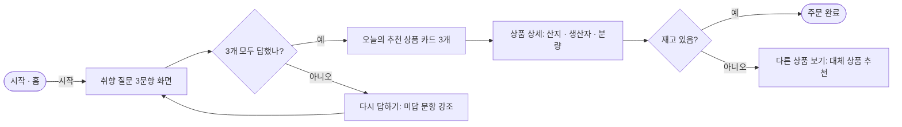

# Day 14 (2026-11-12) 서비스 시나리오 & 스펙 문서: '스펙 주도' 기획의 시작

> 원본: L.L.M Academy Day 14 강의 PDF(26장, v3)를 md로 옮겼다. 표와 목록은 슬라이드 구성대로 정리했고, 가상 예시(대구 식재료 추천, 약령시 K-웰니스)는 강의 원문 그대로 두었다.
> 부제: 페인포인트 · AX 아이디어 · BM 캔버스의 To-Be 시나리오화 · 유저 플로우와 정보 구조 · Claude Code 인터뷰형 spec.md
> v1은 다음 주 MVP 구현의 설계도다.

---

## 1. 오늘의 목표와 산출물

이번 주 앞의 사흘은 "무엇이 문제이고 왜 돈이 되는가"를 다뤘다. 오늘은 **"누가 어떤 화면에서 무엇을 하고, 무엇이 되면 완성인가"**를 spec.md 한 파일로 고정한다.

| 순서 | 주제 | 내용 |
|---|---|---|
| 1 | 서비스 시나리오 | 지금의 불편한 하루(As-Is)와 서비스가 있는 하루(To-Be)를 장면으로 비교하고, 기능을 유저 스토리 + 인수 조건으로 표현 |
| 2 | 스펙 주도 기획 | 프롬프트를 던지는 대신 목표 · 사용자 · 기능 · 제약 · 완료 기준 다섯 요소의 spec.md를 먼저 쓰고 AI에게 구현을 맡김 |
| 3 | 흐름 · 구조 · 화면 | 유저 플로우(화면 · 행동 · 분기)와 정보 구조(IA)를 그리고, Claude Design으로 핵심 화면 시안까지 확인 |

### 결과물 (HRD-net 기준)

- **공통:** spec.md v1 · 유저 플로우 · 핵심 화면 시안
  - `spec/scenario.md`: As-Is → To-Be 시나리오 + 유저 스토리 · 인수 조건
  - `spec/userflow.md`(Mermaid) · `spec/ia.md` · `spec/spec.md` v1 · `spec/screens/` 시안 캡처
- **트랙별 과제**
  - 크리에이티브: `campaign/campaign_plan.md` · `spec/landing_spec.md`
  - **데이터·서비스: `spec/recommend_spec.md` · `spec/dataflow.md`**

### 오늘 쓰는 툴

| 툴 | 쓰임 |
|---|---|
| Claude Code · 인터뷰형 spec | AI가 질문하고 사람이 답하는 인터뷰로 spec.md 작성, 시나리오·플로우 초안 |
| Claude Design · 핵심 화면 | spec의 핵심 화면 2~3개 시안. 다음 주 Claude Code 핸드오프의 출발점 |
| Mermaid (Claude Code 생성) | 유저 플로우 순서도 |
| GitHub 팀 저장소 | 산출물 보관 |

최종 목표와의 연결:
- 크리에이티브 트랙(콘텐츠 & 뷰티): 캠페인 기획안은 최종 AI Agent의 캠페인 템플릿, 랜딩 spec은 에이전트가 만들어 내는 결과물 규격
- 데이터·서비스 트랙(푸드 & 리테일): spec.md와 데이터 흐름도는 대시보드·업무 자동화 서비스의 서비스 명세와 데이터 모델

## 2. 최종 구조도에서 오늘의 위치

시나리오와 유저 스토리는 "사용자가 무엇을 요청하는가"의 정의이고, spec은 에이전트가 받을 요청의 범위다.

**데이터·서비스 트랙 예시 구조 (재고 운영 에이전트 + 대시보드)**

| 역할 | 하는 일 | 도구·파일 |
|---|---|---|
| 사용자 (운영 담당) | 요청 → 최종 답 | — |
| 오케스트레이터 (Claude Code 메인 세션) | 요청 이해 · 위임 · 통합, 사람 승인 → 최종 답 | CLAUDE.md · data_model.md |
| 수집가 | 주문 · 재고 · 외부 변수 | Supabase export, 공개 데이터 |
| 예측 분석가 | 7일 예측 · 보충 시점 | forecast.py, 베이스라인 MAE |
| 대시보드 생성자 | 지표 HTML 시각화 | dashboard_spec.md, stock_dashboard.html |
| 알림 작성자 | 경고 문구 요약 | 알림 규칙 · IF, n8n 웹훅 |
| 검수자 | 수치 검증 · 보안 점검 (읽기 전용) | rubric.md · 골든셋 |
| 출력 | 경고 메일 · 대시보드 | — |

흐름: 요청 수신 → 계획 · 위임 → 결과 수집 → 통합 · 판단 → 사람 승인 → 최종 답

추천 서비스 spec과 dataflow.md가 운영 담당의 요청 범위와 에이전트가 다룰 데이터의 정의다. 전체 그림은 10/27(Day 2)과 12/2(Day 28)에 다룬다.

## 3. 하루 흐름

50분 수업 · 10분 휴식. 시나리오 → 스펙 → 흐름·구조 → 인터뷰형 spec v1 순서로 이론과 실습을 번갈아 진행한다.

| 시간 | 내용 |
|---|---|
| 09:00–09:50 | 1교시 이론: 전일 복습 · 서비스 시나리오(As-Is → To-Be, 유저 스토리) / 실습: To-Be 시나리오 + 유저 스토리 · 인수 조건 |
| 10:00–10:50 | 2교시 이론: 개발 프로세스와 사람의 몫 · 프롬프트 → 스펙, spec.md 작성법 / 실습: spec.md 뼈대 다섯 요소 |
| 11:00–11:50 | 3교시 이론: 유저 플로우 · 정보 구조(IA) / 실습: 유저 플로우(Mermaid) · IA 작성 |
| 12:00–12:50 | 4교시 이론: Claude Code 인터뷰형 spec 작성 시연 · Claude Design 핵심 화면 / 실습: 인터뷰형 spec.md v1 + 핵심 화면 시안 |
| 14:00–16:00 | 복습 · 질의응답, spec.md 상호 점검 |
| 16:00–18:00 | 트랙별 과제 · 산출물 정리 · 회고 |

## 4. 전일 복습: 사흘의 산출물과 spec.md 다섯 칸의 연결

페인포인트 → AX 아이디어 → BM 캔버스는 오늘 새로 쓰는 것이 아니라 **스펙의 재료**다. 어느 파일이 어느 칸으로 가는지 먼저 맞춘다.

| 파일 (작성일) | spec.md에서 가는 칸 |
|---|---|
| `painpoint/painpoint_def.md` (11/9) | 목표: Top 1 페인포인트가 "무엇을 해결하는가"의 문장 |
| `painpoint/journey_map.html` (11/9) | As-Is 시나리오: 여정 단계와 감정 곡선이 지금의 하루 |
| `ax/ideas_top3.md` (11/10) | 기능: Top 1 아이디어의 AI 역할이 핵심 기능 후보 |
| `bm/bm_canvas.md` · `vpc.md` (11/11) | 사용자(고객 세그먼트) · 제공 가치 · 수익 구조 전제 |
| `bm/redteam_log.md` (11/11) | 제약: 보류한 지적, 리스크 · 개인정보 · 저작권 조건 |

**점검 질문 (팀 안에서 답하고 시작)**
- 우리 서비스가 해결하는 페인포인트 하나를 한 문장으로 말할 수 있는가
- BM 캔버스의 고객 세그먼트가 고객 페르소나 1명으로 좁혀지는가
- 레드팀 지적 중 반영하지 않은 것과 그 이유는
- AI가 하는 일과 사람이 확인하는 일이 짝으로 적혀 있는가

어제까지는 사업의 논리였고, 오늘은 그 논리를 사용자의 행동과 화면으로 번역한다. 스펙이 비면 다음 주 MVP에서 AI가 대신 지어낸다.

## 5. 용어 카드

| # | 용어 | 정의 |
|---|---|---|
| 1 | 서비스 시나리오 | 사용자가 서비스를 쓰는 하루를 장면 순서로 적은 이야기. 지금(As-Is)과 바뀐 뒤(To-Be)를 비교 |
| 2 | 유저 스토리 | 기능을 사용자의 말로 적은 한 문장. "~로서, ~하고 싶다, ~하기 위해" |
| 3 | 인수 조건 | 그 유저 스토리가 "됐다"고 받아들일 조건. 확인 가능한 문장 2~4개 |
| 4 | 스펙 · spec.md | 무엇을 만들지 합의한 명세 문서. 목표 · 사용자 · 기능 · 제약 · 완료 기준. AI와 사람이 함께 읽는 기준 |
| 5 | 완료 기준 | 서비스 전체가 완성됐는지 판정하는 체크리스트. 누가 봐도 예/아니오로 답할 수 있어야 함 |
| 6 | 유저 플로우 | 사용자가 목표까지 거치는 화면 · 행동 · 분기의 순서도 |
| 7 | 정보 구조 (IA) | Information Architecture. 화면과 콘텐츠를 어떤 묶음 · 계층 · 이름으로 배치하는가 |
| 8 | 엔터티 | 서비스가 기억해야 하는 대상(사용자 · 상품 · 주문). 속성과 관계를 가진 데이터 모델의 단위 |
| 9 | 핸드오프 · 계획 모드 | 시안을 구현 쪽으로 넘기는 일 / Claude Code가 고치기 전에 계획부터 보여 주는 모드(11/16 상세) |

## 6. 서비스 시나리오: As-Is → To-Be, 같은 사람의 두 하루

기능 목록보다 장면이 먼저다. 같은 고객 페르소나 · 같은 상황에서 무엇이 달라지는지 장면 단위로 비교하면 필요한 기능이 드러난다.

**가상 예시: 대구 1인 가구 직장인의 저녁 장보기**

| | As-Is: 지금의 하루 (여정 지도에서) | To-Be: 서비스가 있는 하루 (같은 사람 · 같은 퇴근길) |
|---|---|---|
| 장면 1 | 퇴근길에 저녁 재료를 찾지만 앱에는 전국 공통 상품만 보임 | 취향 질문 세 개에 답하면 오늘 들어온 대구 식재료 3개를 추천 |
| 장면 2 | 대구 근교 채소가 있다는 블로그 글을 봐도 어디서 사는지 모름 | 추천마다 산지 · 생산자 · 1인 분량이 한 화면에 |
| 장면 3 | 결국 늘 사던 기본 상품 주문, 양이 많아 절반은 버림 | 바로 주문, 다음에는 지난 선택을 반영한 추천 |
| 판매자 쪽 | 다음 주에 얼마나 팔릴지 몰라 감으로 수확 · 포장, 남으면 폐기 | 주문 집계가 쌓여 다음 주 수요 신호로 표시 |

근거: `painpoint_def.md` Top 1 "1인 분량 지역 식재료를 찾기 어렵다". 장면마다 바뀐 이유가 기능 하나 → 유저 스토리 하나가 된다.

- **작성 규칙 1:** 주인공은 고객 페르소나 1명, 상황(언제 · 어디서)을 첫 줄에
- **작성 규칙 2:** To-Be 장면은 As-Is 장면과 1:1 대응, 바뀌지 않는 장면도 적음
- **흔한 오류:** To-Be에 기능 이름만("AI 추천 탑재") 적고 사용자의 행동이 없음

## 7. 유저 스토리와 인수 조건

To-Be 장면 하나 = 유저 스토리 하나. 스토리는 "왜", 인수 조건은 "됐는지 어떻게 아는가"다. 둘이 짝이어야 AI가 구현하고 사람이 확인할 수 있다.

| 누가 | 무엇을 | 왜 | 확인 |
|---|---|---|---|
| ~로서 | ~하고 싶다 | ~하기 위해 | 인수 조건 2~4개 |
| 고객 페르소나 · 판매자 · 운영자 중 한 명. "사용자"처럼 뭉뚱그리지 않음 | 화면에서 하는 행동 하나. 기술 용어 대신 사용자의 동사 | 페인포인트와 연결되는 이유. 이유가 없으면 그 기능은 MVP 밖 | "~하면 ~가 보인다"처럼 화면에서 예/아니오로 확인되는 문장 |

**데이터·서비스 트랙 가상 예시**
- 스토리: 대구 근교 채소 생산자로서, 다음 주 품목별 예상 주문량을 보고 싶다, 수확 · 포장량을 정해 폐기를 줄이기 위해
- 인수 조건:
  - 품목별 지난 4주 주문량과 다음 주 예상치가 표로 보인다
  - 예상치 옆에 계산 방법이 한 줄로 적혀 있다
  - 주문 데이터가 없는 품목은 "데이터 부족"으로 표시된다

**크리에이티브 트랙 가상 예시**
- 스토리: 대구를 처음 찾은 외국인 관광객으로서, 내 피부 고민에 맞는 한방 웰니스 루틴을 영어로 보고 싶다, 약령시에서 무엇을 사야 할지 정하기 위해
- 인수 조건: 고민 질문 3개에 답하면 루틴 1개와 상품 3개가 보인다 / 모든 문구가 영어 · 한국어로 전환된다 / 상품마다 약령시 안 위치가 표시된다

**좋은 스토리 점검:** 한 스토리에 행동 하나 · 이유가 페인포인트에서 옴 · 인수 조건이 화면에서 확인됨. MVP는 스토리 3~5개로 시작한다.

## 8. 1교시 실습: To-Be 시나리오 + 유저 스토리

**목표:** `spec/scenario.md`. As-Is · To-Be 장면 4~6개 대응표 + 유저 스토리 3~5개(인수 조건 포함)

| 단계 | 내용 |
|---|---|
| 1 주인공 · 상황 확정 | 고객 페르소나 1명과 상황 한 줄을 scenario.md 첫 줄에 |
| 2 As-Is 장면 초안 | 여정 지도 단계에서 장면 추출, 장면마다 근거 파일 |
| 3 To-Be 장면 합의 | Top 1 아이디어가 바꾸는 장면만 팀이 고름. 바뀌지 않는 장면은 그대로 |
| 4 유저 스토리 · 인수 조건 | 바뀐 장면마다 스토리 1개 + 조건 2~4개, 우선순위 표시(필수 / 나중) |

**프롬프트 예시**
```
painpoint/journey_map.md · painpoint/painpoint_def.md · ax/ideas_top3.md · bm/vpc.md
를 읽고 spec/scenario.md 를 만들어 줘.
1) 고객 페르소나 1명의 As-Is 장면 4~6개 (여정 단계 순서, 장면마다 근거 파일 경로)
2) Top 1 아이디어가 있을 때의 To-Be 장면을 1:1로 대응
3) 바뀐 장면마다 유저 스토리 "~로서, ~하고 싶다, ~하기 위해"
   + 인수 조건 2~4개 (화면에서 예/아니오로 확인되는 문장)
근거 파일에 없는 사실은 쓰지 말고 "확인 필요"로 표시.
```

**완료 기준**
- As-Is · To-Be 장면이 1:1로 대응, 주인공 1명
- 유저 스토리 3~5개, 이유가 페인포인트와 연결
- 인수 조건이 모두 화면에서 확인 가능한 문장

팀 진행: Claude Code 실행 결과는 팀원 전원이 화면으로 함께 확인하고, 근거 대조 후 팀 합의로 확정한다.

## 9. 개발 프로세스: AI가 맡는 단계와 사람의 몫

요구사항 정의 → 설계 → 구현 → 테스트 → 배포 → 운영. AI 코딩 도구가 빠르게 해 주는 것은 구현이다. 그 앞뒤가 비어 있으면 결과를 통제할 수 없다.

| 단계 | 무엇 | 담당 | 산출물 | 일정 |
|---|---|---|---|---|
| 요구사항 정의 | 무엇을 · 왜 | 사람 | spec.md (scenario.md 포함) | 11/12 |
| 설계 | 흐름 · 구조 · 데이터 모델 | 사람 + AI 보조 | userflow · ia.md, 화면 시안 · 데이터 모델 | 11/12 |
| 구현 | 코드 작성 · 수정 | AI | 코드 · commit (Claude Code 계획 모드) | 11/16 MVP |
| 테스트 | 완료 기준 확인 | 사람 | 완료 기준 체크 결과, 사용자 테스트 기록 | 11/17 |
| 배포 | push → 빌드 → URL | 자동 · Vercel | 배포 URL, 피칭 데모 링크 | 11/16 ~ |
| 운영 | 이력 · 지표 · 개선 | 사람 | 이력 · 지표, v2 재구축 · DB 연동 | 11/26 ~ 12/3 |

- 설계의 산출물이 곧 md 파일이다. 흐름 · 구조 · 데이터 모델을 문서로 남겨야 AI가 같은 그림으로 구현한다.
- 요구사항과 테스트는 사람의 몫이다. 무엇이 필요한지, 됐는지 판정하는 일은 위임할 수 없다. spec.md의 완료 기준이 둘을 잇는 끈이다.

**미리 보기: 설정값은 환경변수로 (11/16 · 11/27 상세)**
- 환경변수: 코드 밖에 "이름=값"으로 두는 설정값. 같은 이름에 실행 장소마다 다른 값
- 로컬(내 PC): `.env.local` 파일에 API 키 등 값 보관, GitHub에 올리지 않음(`.gitignore`)
- 코드(저장소): 값이 아니라 이름만 참조. 키를 코드에 직접 적지 않음
- 운영(Vercel): 프로젝트 설정의 Environment Variables에 같은 이름 · 운영 값
- spec.md "제약" 칸에 **"키는 환경변수로"** 한 줄을 오늘 미리 적어 둔다.

AI가 맡는 단계는 구현이다. 요구사항 · 설계(= md 파일) · 테스트 · 운영 판단은 사람이 쥐어야 결과를 통제할 수 있다.

## 10. 2026 트렌드: 프롬프트 던지기에서 스펙 우선으로

스펙 주도 개발(spec-driven development): 구현 전에 요구사항 · 설계 · 작업 목록을 문서로 쓰고, AI가 그 문서를 기준으로 계획 · 구현한다. 도구들이 같은 방향으로 수렴하고 있다.

| 도구·글 | 내용 |
|---|---|
| GitHub Spec Kit (2025.9 공개) | 명세 → 계획 → 작업 → 구현. `/speckit-specify` → `/speckit-plan` → `/speckit-tasks` → `/speckit-implement` 순서(공개 당시 이름 `/specify` · `/plan` · `/tasks`). 명세는 "무엇을 · 왜", 계획은 "어떤 기술로", 작업은 쪼갠 할 일 목록. 사람은 단계마다 문서를 검토 · 수정 |
| Kiro (스펙 기반 개발 도구) | 스펙을 세 파일로 분리: requirements · design · tasks. 요구사항은 유저 스토리 + EARS 형식 인수 조건. EARS = "WHEN [조건] THE SYSTEM SHALL [동작]", 한국어로 "~할 때, 시스템은 ~한다" |
| Böckeler, martinfowler.com (2025.10) | 스펙 활용의 세 수준: spec-first(작업 전에 스펙을 쓰고 그 작업에 사용) · spec-anchored(작업 뒤에도 스펙을 유지 · 갱신하며 기능 변경의 기준으로) · spec-as-source(스펙이 원본, 코드는 생성물) |

| 비교 | 프롬프트 던지기 (바이브코딩) | 스펙 먼저 (이 과정의 방식) |
|---|---|---|
| 시작 | "추천 앱 만들어 줘" 한 줄 | spec.md 다섯 요소 → 계획 확인 → 구현 |
| 빈칸은 누가 | AI가 그럴듯하게 채움, 매번 다르게 | 사람이 문서로 결정, AI는 문서를 따름 |
| 완성 판정 | "잘 되는 것 같다" | 완료 기준 체크리스트 예/아니오 |
| 이 과정에서 | 아이디어 검증용 빠른 시제품 | 11/12 spec v1 → 11/26 spec v2로 MVP 재구축 → 11/27 DB 연동 |

출처(2026.10 기준): github.blog(Spec Kit, 2025.9.2) · github.com/github/spec-kit · kiro.dev/docs/specs · martinfowler.com/articles/exploring-gen-ai/sdd-3-tools.html

## 11. spec.md 작성법: 목표 · 사용자 · 기능 · 제약 · 완료 기준

한 화면에서 두 화면 분량. 요소마다 재료 파일이 정해져 있고, 빈 요소가 있으면 구현 단계에서 AI가 대신 결정한다.

| 요소 | 묻는 질문 | 재료 파일 | 작성 규칙 |
|---|---|---|---|
| 목표 | 무엇을 해결하는가 | painpoint_def.md | 페인포인트 한 문장 + 성공 신호 1~2개 |
| 사용자 | 누가 · 어떤 상황에서 | bm_canvas · 페르소나 | 주 사용자 1명 · 보조 1명까지 |
| 기능 | 무엇을 할 수 있는가 | scenario.md | 유저 스토리 3~5개, 필수 / 나중 구분 |
| 제약 | 무엇을 하지 않는가 | redteam_log · risk | 범위 밖 · 데이터 · 개인정보 · 도구 · 키 |
| 완료 기준 | 언제 끝났다고 하는가 | 인수 조건 모음 | 예/아니오 체크리스트 5~10개 |

**spec.md 뼈대 (데이터·서비스 가상 예시)**
```markdown
# 대구 오늘의 식재료 추천 — spec v1
## 목표
1인 가구가 1인 분량 지역 식재료를 찾지 못해 기본 상품을 사고 남기는 문제 해결
## 사용자
주: 대구 거주 1인 가구 직장인(퇴근길 모바일)
보조: 근교 채소 생산자(주간 주문 확인)
## 기능 (필수)
- 취향 질문 3개 → 오늘의 추천 3개
- 추천 상품의 산지 · 생산자 · 분량 표시
- 생산자용 품목별 주간 주문 집계
## 제약
- 결제는 MVP 범위 밖(주문 의사만 저장)
- 개인정보는 닉네임만, 키는 환경변수로
## 완료 기준
- [ ] 질문 3개 답 → 추천 3개가 보인다
- [ ] 재고 0인 상품은 추천에 없다
```

- **제약이 기능만큼 중요하다.** "하지 않는 것"을 적지 않으면 AI가 로그인 · 결제 · 관리자 화면까지 만들어 범위가 커진다.
- **흔한 오류:** 목표에 기능을 씀("추천 앱 만들기") · 사용자가 "누구나" · 완료 기준이 "잘 동작한다"

## 12. 좋은 완료 기준: 누가 봐도 예/아니오

완료 기준은 테스트 단계에서 사람이 쓰는 채점표이자, AI가 구현 후 스스로 확인하는 목록이다. 모호하면 둘 다 "됐다"고 말한다.

| 모호한 기준 | 확인 가능한 기준 ("~할 때, 시스템은 ~한다") | 고친 이유 |
|---|---|---|
| 추천이 정확하다 | 질문 3개에 답할 때, 시스템은 답과 맞는 태그의 상품 3개를 보여 준다 | 정확함 → 조건 · 개수 |
| 모바일에서 잘 보인다 | 폭 375px 화면에서 가로 스크롤 없이 모든 버튼이 보인다 | 잘 → 측정 가능한 폭 |
| 오류 처리가 된다 | 재고가 0일 때, 시스템은 그 상품 대신 같은 분류의 다른 상품을 보여 준다 | 예외 상황 하나씩 |
| 다국어 지원 | 언어 버튼을 누를 때, 화면의 모든 문구가 영어 ↔ 한국어로 바뀐다 | 범위 · 행동 명시 |
| 예쁘게 만든다 | 색 · 글꼴이 brand 스킬의 비주얼 키워드 · 금칙 색 규칙을 따른다 | 취향 → 기준 파일 |

**네 원칙**
1. 관찰 가능: 화면이나 파일에서 눈으로 확인
2. 하나만: 한 문장에 조건 하나 · 결과 하나
3. 예외 포함: 데이터 없음 · 재고 0 · 빈 입력
4. 유저 스토리 추적: 기준마다 어느 스토리에서 왔는지

"~할 때, 시스템은 ~한다" 형식은 EARS(Easy Approach to Requirements Syntax · Rolls-Royce, 2009)의 WHEN … SHALL 패턴을 한국어로 옮긴 것이다.

## 13. 2교시 실습: spec.md 뼈대 다섯 요소

재료 파일에서 목표 · 사용자 · 제약을 먼저 채우고, 기능과 완료 기준은 1교시 유저 스토리에서 옮긴다. 4교시 인터뷰로 빈칸을 메우기 위한 v0다.

**목표:** `spec/spec.md` v0. 다섯 요소 제목 아래 재료에서 옮긴 내용 + 빈칸 질문 목록

| 단계 | 내용 |
|---|---|
| 1 재료 매핑 | 복습 장의 표대로 다섯 요소와 재료 파일을 짝지음 |
| 2 뼈대 생성 | 프롬프트로 v0 생성, 요소마다 출처 파일 표시 |
| 3 완료 기준 고쳐 쓰기 | 인수 조건을 "~할 때, 시스템은 ~한다"로, 모호한 기준은 네 원칙으로 수정 |
| 4 빈칸 질문 목록 | 팀이 아직 결정 못 한 것을 open_questions 절에. 4교시 인터뷰의 출발점 |

**프롬프트 예시**
```
spec/scenario.md · painpoint/painpoint_def.md · bm/bm_canvas.md · bm/redteam_log.md 를 읽고
spec/spec.md v0를 만들어 줘.
- 제목: 목표 · 사용자 · 기능 · 제약 · 완료 기준
- 기능은 scenario.md 유저 스토리를 필수 / 나중으로 구분
- 완료 기준은 "~할 때, 시스템은 ~한다" 문장, 체크박스
- 요소마다 출처 파일을 괄호로
- 재료에 없는 결정은 지어내지 말고 맨 아래 "open_questions" 목록에 질문으로
```

**완료 기준**
- 다섯 요소 제목이 모두 있고 출처 표시
- 제약 3개 이상: 범위 밖 · 개인정보 · 키 관리
- 완료 기준 5개 이상, 모호한 단어 없음
- open_questions 3개 이상

## 14. 유저 플로우: 화면 · 행동 · 분기의 순서도

시나리오가 이야기라면 유저 플로우는 길 안내도다. 사용자가 목표까지 거치는 화면과 그 사이의 행동, 갈림길(분기)을 기호로 그린다.

**가상 예시 (추천 서비스의 주 경로와 예외 경로)**


| 기호 | 뜻 |
|---|---|
| 둥근 상자 | 시작 · 끝 |
| 사각 상자 | 화면 하나 |
| 마름모 | 분기(예 / 아니오 질문) |
| 화살표 + 라벨 | 사용자의 행동 |

**그리는 순서:** 목표 화면(끝)을 먼저 정하고 시작에서 잇는 최단 경로 → 유저 스토리마다 그 경로 위 어느 화면인지 표시 → 인수 조건의 예외(빈 입력 · 재고 0)를 분기로 추가

**Mermaid:** 글로 쓰면 순서도가 그려지는 표기법. Claude Code가 작성하고 GitHub에서 그림으로 표시된다. userflow.md 안에 그대로 보관 · 수정한다.

## 15. 정보 구조(IA): 내용 · 위치 · 이름의 설계

유저 플로우가 "순서"라면 IA는 "지도"다. 화면과 콘텐츠를 묶고(사이트맵), 오가는 길을 정하고(내비게이션), 이름을 붙인다(라벨링).

**사이트맵 예시 (약령시 K-웰니스 기획전 랜딩, 가상)**
- 홈 · 기획전 소개
  - 캐릭터 이야기
  - 웰니스 Q&A → 고민 질문 3개 → 루틴 결과 → 추천 상품 3개
  - 상품 모아보기
  - 약령시 동선 → 지도 · 점포 위치 · 영어/한국어 → 방문 체크리스트
  - 자주 묻는 질문

| 원칙 | 내용 |
|---|---|
| 1 사이트맵: 묶음과 계층 | 콘텐츠를 사용자가 찾는 방식대로 묶고, 홈에서 세 번 이내로 닿게. 깊이보다 넓이 |
| 2 내비게이션: 오가는 길 | 상단 메뉴 · 하단 탭 · 뒤로 가기. 유저 플로우의 주 경로가 메뉴 한 번에 시작되는가 |
| 3 라벨링: 사용자의 말로 | "큐레이션" 대신 "오늘의 추천". 리뷰 · VOC에서 사용자가 쓴 단어를 메뉴 이름으로 |

**IA 점검:** 유저 스토리마다 사이트맵의 화면 하나에 닿는가 · 어떤 스토리에도 쓰이지 않는 화면은 MVP에서 제외 · 라벨은 brand 스킬의 말투로

## 16. 3교시 실습: 유저 플로우(Mermaid) · IA

spec v0의 필수 기능을 주 경로로 잇고 예외를 분기로 추가한다. 같은 화면 목록으로 사이트맵을 만들어 스토리 ↔ 화면 대응표까지 만든다.

**목표:** `spec/userflow.md`(Mermaid 주 경로 + 예외 2개 이상) · `spec/ia.md`(사이트맵 + 스토리 ↔ 화면 대응표)

| 단계 | 내용 |
|---|---|
| 1 화면 목록 | 필수 유저 스토리에서 필요한 화면 5~8개를 팀이 결정 |
| 2 플로우 생성 | 프롬프트로 Mermaid 순서도, 커밋 · push 후 GitHub에서 그림으로 확인 |
| 3 예외 분기 | 완료 기준의 예외(빈 입력 · 데이터 없음)를 마름모로 추가 |
| 4 IA · 대응표 | 사이트맵과 라벨, 스토리마다 닿는 화면 표. 빈 화면은 제외 |

**프롬프트 예시**
```
spec/spec.md 의 필수 기능과 spec/scenario.md 를 읽고
1) spec/userflow.md 에 Mermaid flowchart 를 써 줘.
   화면은 사각형, 분기는 마름모, 화살표에 사용자 행동 라벨.
   주 경로 하나 + 완료 기준의 예외 경로 2개 이상.
2) spec/ia.md 에 사이트맵(들여쓰기 목록, 깊이 3 이내)과
   유저 스토리 ↔ 화면 대응표를 만들어 줘.
화면 이름은 우리가 정한 목록만 쓰고, 새 화면이 필요하면 추가하지 말고 질문으로 남겨 줘.
```

**완료 기준**
- Mermaid가 GitHub에서 그림으로 보임
- 필수 스토리 모두 경로 위에 있음, 예외 분기 2개 이상
- 사이트맵 깊이 3 이내, 라벨은 사용자의 말

이어지는 곳: 화면 목록은 4교시 Claude Design 시안의 입력, 대응표는 spec v1 "기능" 절의 근거다.

## 17. 인터뷰형 spec 작성: AI가 질문하고 내가 답함

빈칸을 AI가 추측으로 채우게 두지 않고, AI에게 질문을 시켜 사람이 결정한다. Anthropic Claude Code 공식 모범 사례에 "Claude가 나를 인터뷰하게 하기"로 소개된 방식이다.

| 순서 | 내용 |
|---|---|
| 1 재료와 함께 인터뷰 요청 | spec v0 · userflow · ia를 읽히고 "나를 인터뷰해 줘"로 시작 |
| 2 객관식 질문에 답하기 | Claude Code가 AskUserQuestion 도구로 선택지 질문: 화면 · 예외 · 우선순위 · 트레이드오프(하나를 얻으면 다른 하나를 포기하는 선택) |
| 3 모르는 질문은 보류 | "팀 결정 필요"로 답하면 open_questions에 남김. 추측 금지 |
| 4 spec.md v1 저장 · 검토 | 답이 반영된 다섯 요소를 사람이 읽고 수정, 커밋 |
| 5 구현은 새 세션에서 | 깨끗한 컨텍스트로 spec.md만 읽고 시작 (11/16 계획 모드) |

**프롬프트 예시**
```
spec/spec.md(v0) · spec/userflow.md · spec/ia.md 를 읽고
AskUserQuestion 도구로 나를 자세히 인터뷰해 줘.
- 화면 구성, 예외 상황, 우선순위, 데이터, 트레이드오프를 물어 줘
- 이미 파일에 답이 있는 뻔한 질문은 건너뛰어 줘
- 질문은 선택지와 함께 하나씩
- 내가 "팀 결정 필요"라고 답하면 open_questions 에 남겨 줘
모든 답을 받으면 spec/spec.md 를 v1 로 완성해 줘.
완료 기준은 "~할 때, 시스템은 ~한다" 문장으로.
```

**좋은 인터뷰 답의 조건**
- 근거 파일이 있는 답은 파일 이름까지 말함
- "알아서" 대신 선택지 중 하나 또는 보류
- 답할 때마다 제약이 늘었는지 확인. 범위가 커지면 "나중"으로

출처(2026.10 기준): code.claude.com/docs/en/best-practices "Let Claude interview you". 인터뷰 후 SPEC.md 작성, 구현은 새 세션 권장.

## 18. Claude Design 핵심 화면 시안

대화로 시안 · 프로토타입을 만드는 Anthropic Labs 도구. 오늘은 spec의 핵심 화면 2~3개만 만들고, 11/16에 Claude Code로 핸드오프해 구현한다.

| 입력 | 톤 | 대화 | 11/16 |
|---|---|---|---|
| spec.md + ia.md. 핵심 화면 2~3개의 목적 · 들어갈 정보 · 행동 버튼 | brand 스킬 요약. 말투 · 비주얼 키워드 · 금칙 색을 붙여 넣어 시안의 톤 고정 | 시안 → 수정 요청. 보이는 문제를 그대로 말하기("추천 카드에 산지를 첫 줄로") | Claude Code 핸드오프. 시안 묶음을 Claude Code로 넘겨 계획 모드로 구현 |

**확인된 사실**
- 출시: 2026.4.17 리서치 프리뷰 → 2026.10.8 베타 해제
- 대상: Free 포함 전 플랜, 사용량은 Claude 공통 한도에서 차감(Enterprise는 관리자 활성화 필요)
- 내보내기: Canva · PDF · PPTX · 단독 HTML, 조직 내 URL 공유
- 핸드오프: 시안 묶음을 Claude Code로 전달해 구현

**프롬프트 예시**
```
모바일 웹 서비스의 핵심 화면 3개 시안을 만들어 줘.
① 취향 질문 3문항 ② 오늘의 추천 카드 3개 ③ 상품 상세(산지 · 생산자 · 1인 분량)
- 들어갈 정보와 버튼은 아래 spec 발췌만 사용
- 톤: 차분한 존댓말, 비주얼 키워드 [brand 스킬 발췌]
- 폭 375px 기준, 버튼은 엄지로 누르기 쉬운 크기
[spec.md 기능 · 완료 기준 발췌 붙여 넣기]
```

**시안 점검:** 화면마다 유저 스토리 하나에 대응 · spec에 없는 기능 버튼이 없음 · 예외 화면(데이터 없음) 1개 이상 · 캡처를 `spec/screens/`에, 링크를 spec.md에

출처(2026.10 기준): anthropic.com/news/claude-design-anthropic-labs. 접속 가능 계정은 팀 시트에서 확인.

## 19. 4교시 실습: 인터뷰형 spec.md v1 + 핵심 화면 시안

한 명은 Claude Code 인터뷰에 답하고 팀이 옆에서 결정, 다른 한 명은 결정된 화면부터 Claude Design 시안을 만든다. v1을 커밋하면 오늘의 공통 산출물이 완성된다.

**목표:** `spec/spec.md` v1 커밋 + `spec/screens/` 핵심 화면 2~3개 캡처 · 링크

| 단계 | 내용 |
|---|---|
| 1 인터뷰 진행 | 4교시 이론 장의 프롬프트로 시작, 답변자 1인 + 결정 전원 |
| 2 v1 검토 | 작성자 아닌 팀원이 다섯 요소 · 완료 기준 네 원칙으로 점검 |
| 3 핵심 화면 시안 | 대응표에서 필수 스토리 화면 2~3개를 Claude Design으로, 수정 요청 1회 이상 |
| 4 저장 · 커밋 | 캡처를 `spec/screens/`에, 시안 링크를 spec.md "화면" 절에, 커밋 "docs: spec v1" |

**spec.md v1 완료 기준**
- 다섯 요소 모두 채움, open_questions는 담당자와 기한 표시
- 필수 기능 3~5개, 모두 유저 스토리 · 화면과 대응
- 제약에 범위 밖 · 개인정보 · 키 관리 · 사용 도구
- 완료 기준 5~10개, 예외 2개 이상, 모두 예/아니오로 판정 가능
- 핵심 화면 시안 2~3개, spec에 없는 기능 없음

**인터뷰 후 자기 점검**
- 인터뷰 중 "알아서 해 줘"라고 답한 질문이 있었는가. 있으면 다시 결정
- v0보다 제약이 늘었는가. 늘지 않았다면 범위가 커졌을 가능성

Claude Design 접속이 안 되는 팀은 Claude Code로 HTML 와이어프레임(색 · 이미지 없이 배치만 그린 화면 뼈대)을 한 장씩 만들어 같은 위치에 저장한다.

## 20. 복습 · 질의응답: 시나리오에서 spec까지 한 줄로 잇기

옆 팀과 spec.md를 바꿔 읽어 "이 문서만 보고 만들 수 있는가"를 점검한 뒤 과제로 넘어간다.

**당일 핵심 개념**
1. 서비스 시나리오 · 유저 스토리: As-Is ↔ To-Be 장면 1:1, 바뀐 장면마다 "~로서, ~하고 싶다, ~하기 위해" + 인수 조건
2. 개발 프로세스 · 스펙 주도: AI는 구현, 요구사항 · 설계 · 테스트 · 운영은 사람. spec.md 다섯 요소, 완료 기준 네 원칙
3. 유저 플로우 · IA: 화면 · 행동 · 분기의 순서도, 사이트맵 · 내비게이션 · 라벨링
4. 인터뷰형 spec · 핵심 화면: AI가 묻고 사람이 결정, 모르면 보류. Claude Design 시안 → 11/16 핸드오프

**점검 질문 (옆 팀 spec.md로 답하기)**
- 이 spec만 읽고 첫 화면을 그릴 수 있는가
- 완료 기준 중 판정이 갈리는 문장은 무엇인가
- "하지 않는 것"이 적혀 있는가
- 유저 스토리마다 닿는 화면이 있는가
- open_questions에 담당자가 있는가

**자주 막히는 지점과 처방**
- 기능이 계속 늘어남: 페인포인트 Top 1과 무관한 기능은 "나중"으로
- 인터뷰가 끝나지 않음: "필수 기능 범위에서만 질문" 조건 추가
- Mermaid 오류: 오류 메시지를 그대로 붙여 넣고 수정 요청

## 21. 과제: 트랙별

공통 spec.md v1을 트랙 결과물로 구체화한다. 산출물 이름은 최종 프로젝트의 부품 이름이다.

### AX 데이터·서비스 트랙 (푸드 & 리테일)

**산출물:** 서비스 명세(`spec/recommend_spec.md`) · 데이터 모델(`spec/dataflow.md`)

- 추천 서비스 spec: 추천 규칙(어떤 입력으로 무엇을 고르는가)을 문장으로
- 데이터 흐름도: 입력 → 추천 → 주문 → 수요예측, 단계마다 생기는 데이터
- 데이터 모델: 엔터티 4~6개 · 속성 · 관계(1:N)
- 지난주 데이터 명세 · 밸류체인 데이터 층과 이름 맞추기

**완료 기준:** 흐름도 4단계 · 엔터티 4개 이상 · 엔터티마다 데이터 출처 · 추천 규칙 3줄 이상

### AX 크리에이티브 트랙 (콘텐츠 & 뷰티)

**산출물:** 캠페인 템플릿(`campaign/campaign_plan.md`) · 결과물 규격(`spec/landing_spec.md`)

- K-웰니스 기획전 캠페인 기획안: 목적 · 타깃 · 메시지 · 채널 · KPI 다섯 칸
- 메시지는 brand 스킬의 핵심 메시지에서, 타깃은 고객 페르소나 1명
- 랜딩 spec: 다섯 요소 + 섹션 목록, Q&A 섹션은 AEO 구조(답변 우선 문단)
- 랜딩 핵심 화면 1개 Claude Design 시안

**완료 기준:** 기획안 다섯 칸 · KPI 2개 이상에 측정 방법 · 랜딩 spec 완료 기준 5개 이상 · Q&A 5문항

**공통:** 트랙 산출물의 기능 · 제약이 spec.md v1과 어긋나면 spec.md를 함께 고치고 변경 이유를 커밋 메시지에 적는다.

## 22. 데이터·서비스 가이드: 데이터 흐름도와 데이터 모델 기초

흐름도는 "데이터가 어디서 생겨 어디로 가는가", 데이터 모델은 "서비스가 무엇을 기억하는가"다. 11/27 DB 연동의 테이블 설계도가 된다.

**흐름도 (가상 예시)**

| 1 입력 | 2 추천 | 3 주문 | 4 수요예측 |
|---|---|---|---|
| 취향 응답 · 상품 등록(생산자) · 재고 수량 | 응답 태그 × 상품 태그 일치 + 재고 있음 → 3개 | 주문 · 주문 항목 저장(결제는 범위 밖) | 품목별 주간 주문 집계 → 다음 주 예상(이동평균 등) |

**데이터 모델 (가상 예시)**

| 엔터티 | 주요 속성 | 관계 |
|---|---|---|
| 사용자 | id · 닉네임 · 취향 태그 | 사용자 1 : N 주문 |
| 생산자 | id · 이름 · 산지(구 · 군) | 생산자 1 : N 상품 |
| 상품 | id · 품목 · 태그 · 1인 분량 · 재고 | 상품 1 : N 주문 항목 |
| 주문 | id · 사용자 id · 주문 시각 | 주문 1 : N 주문 항목 |
| 주문 항목 | 주문 id · 상품 id · 수량 | 수요예측 집계의 원천 |

용어: 엔터티 = 기억할 대상(나중에 표 하나) · 속성 = 그 대상의 항목(표의 열) · 관계 1 : N = 하나가 여러 개를 가짐 · id = 행을 구분하는 번호, 관계를 잇는 열쇠

**점검:** 완료 기준에 나오는 모든 정보가 어느 엔터티의 속성인가 · 개인정보 속성은 최소한인가. 수요예측 방법은 12/1 데이터 분석에서 상세히 다룬다.

## 23. 크리에이티브 가이드 (요약)

- 콘텐츠 기획안 다섯 칸: 목적(캠페인이 끝나면 무엇이 달라지는가) · 타깃(고객 페르소나 1명 · 상황) · 메시지(반복할 한 문장) · 채널(어디서 만나는가) · KPI(무엇으로 확인하는가 · 측정 방법)
- AEO(Answer Engine Optimization): 질문에 대한 직접 답으로 선택되도록 최적화
- GEO(Generative Engine Optimization): ChatGPT · Perplexity · AI 오버뷰 같은 생성형 답변 안에 출처로 인용되도록 최적화
- 랜딩 Q&A 규칙: 제목은 사용자가 묻는 질문 그대로 · 첫 문장이 답 · 질문 하나 = 문단 하나 · 사실에는 출처, 효능 단정 표현 금지

## 24. 과제 마무리: 포트폴리오 한 줄

채용 담당자가 읽을 문장: 무엇을 · 어떤 데이터로 · 어떤 AI 도구로 · 어떤 결과를. 오늘 산출물로 한 줄을 쓰고 README에 저장한다.

- 데이터·서비스 예시(직무: AI서비스 기획자): "대구 지역 식재료 추천 서비스의 spec.md와 데이터 흐름도(입력 → 추천 → 주문 → 수요예측) 작성 — 페인포인트 · BM 근거로 기능과 완료 기준 정의(Claude Code 인터뷰형 스펙 작성) — [측정값: 기능 ○개 · 예/아니오로 판정되는 완료 기준 ○개 · 엔터티 ○개]"
- 작성 규칙: 11/11 다섯 칸 양식 · ○는 실제 센 값만 · 데이터 출처 꼬리표 필수 · 도구 이름은 실제 쓴 것만 · "완성"이 아니라 "설계 · v1"로. `portfolio/README.md`에 날짜와 함께 누적

## 25. 산출물 정리 · 팀 공유 · 회고

**제출 체크리스트 (팀 GitHub 저장소 `spec/`)**
- scenario.md · userflow.md · ia.md
- spec.md v1 · screens/ 캡처와 링크
- 데이터·서비스: recommend_spec.md · dataflow.md
- 커밋 메시지 "docs: spec v1 + track"

**공유 · 회고**
- 팀 시트: 서비스 이름 · 목표 한 문장 · spec.md 경로
- 회고 1: 인터뷰에서 가장 답하기 어려웠던 질문
- 회고 2: "하지 않는 것"으로 뺀 기능과 이유
- 회고 3: 옆 팀이 판정하기 어렵다고 한 완료 기준

**다음 수업 (11/13 금): 시장 검증, 경쟁 분석과 수익성 시뮬레이션**
- 오늘의 spec.md v1을 바깥에서 검증: 경쟁 · 시장 · 수익 세 질문
- 경쟁 · 대체재 · 포지셔닝 맵, 시장 규모(TAM · SAM · SOM)
- Claude Code로 수식이 살아 있는 시뮬레이션 xlsx
- 준비물: spec.md v1 · bm 파일 · 물류 비용 산정(데이터·서비스) · 기획전 수익 구조(크리에이티브)

오늘의 산출물은 spec.md v1 · 유저 플로우 · 핵심 화면 시안이다(데이터·서비스: 추천 서비스 spec · 데이터 흐름도). 11/16 MVP는 이 spec을 새 세션에서 읽는 것으로 시작한다.
